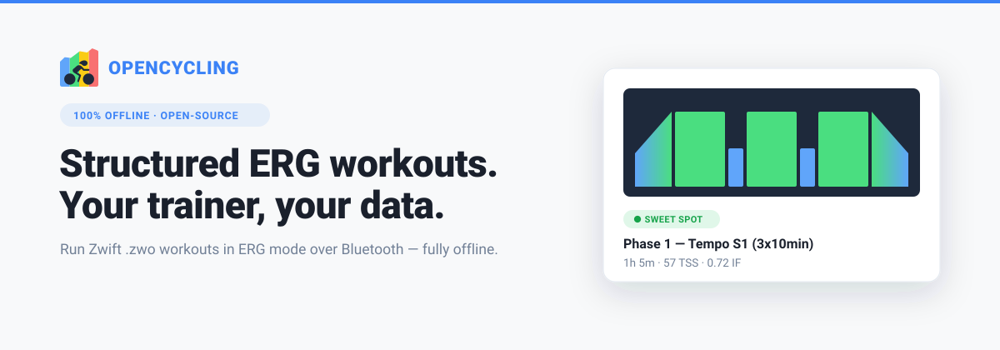
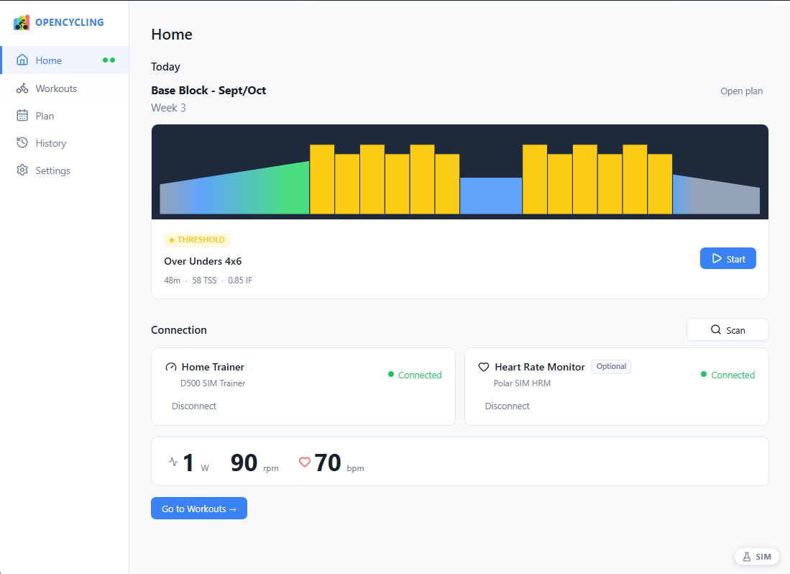
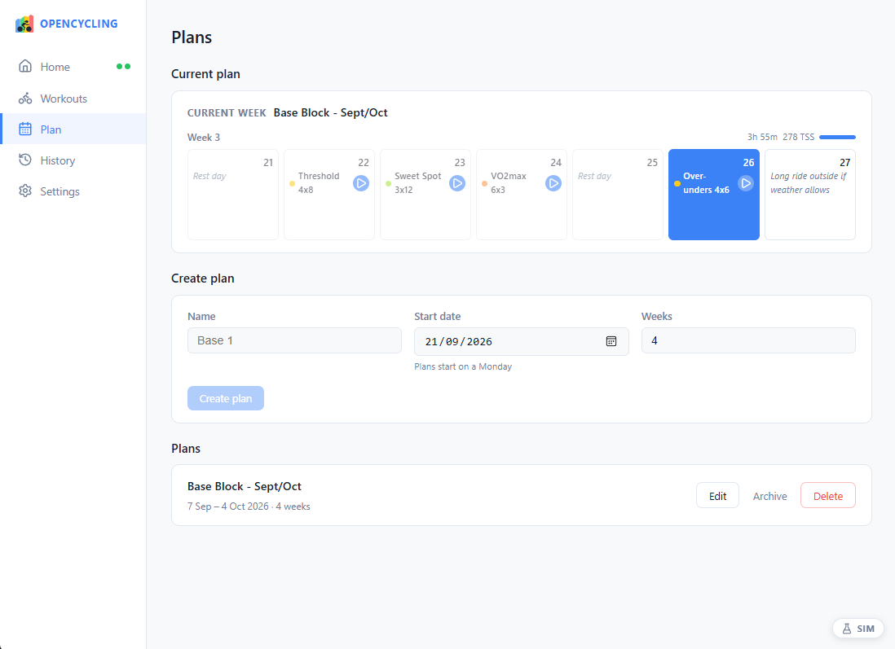
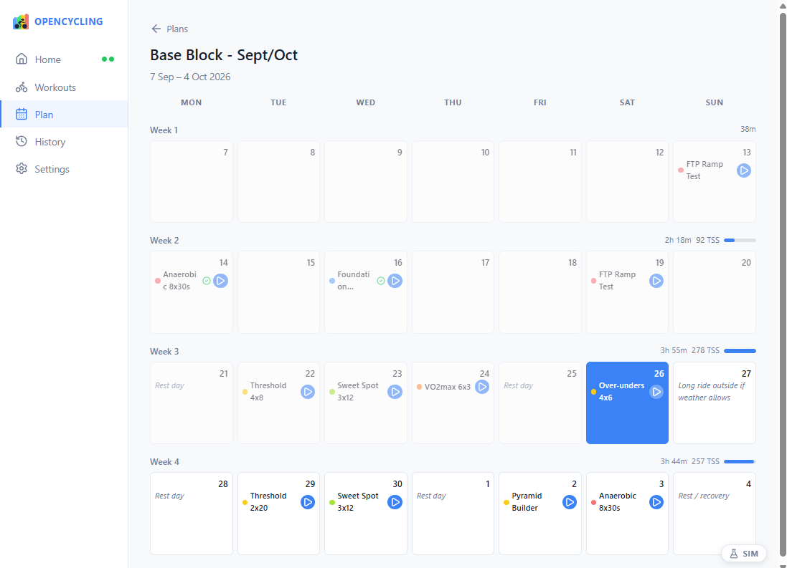
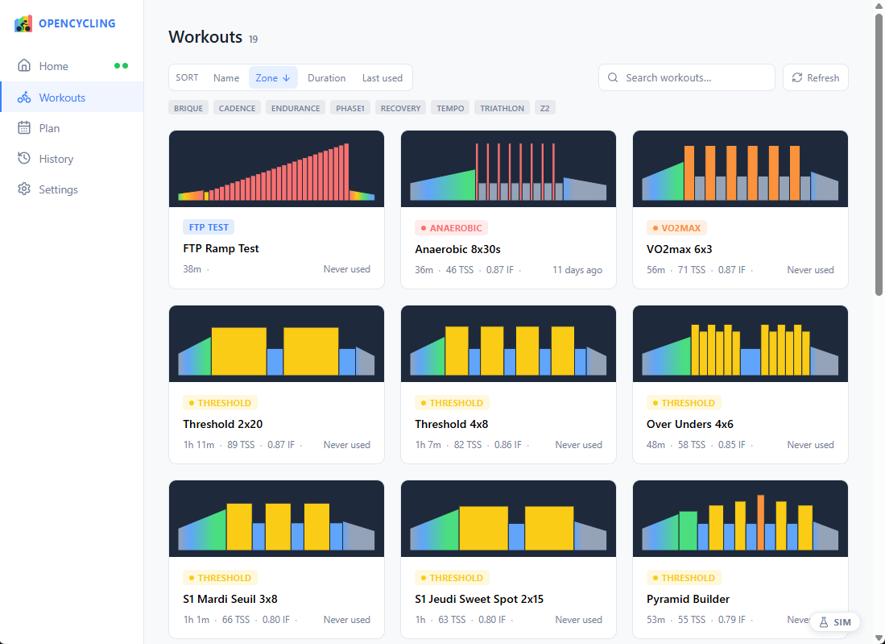
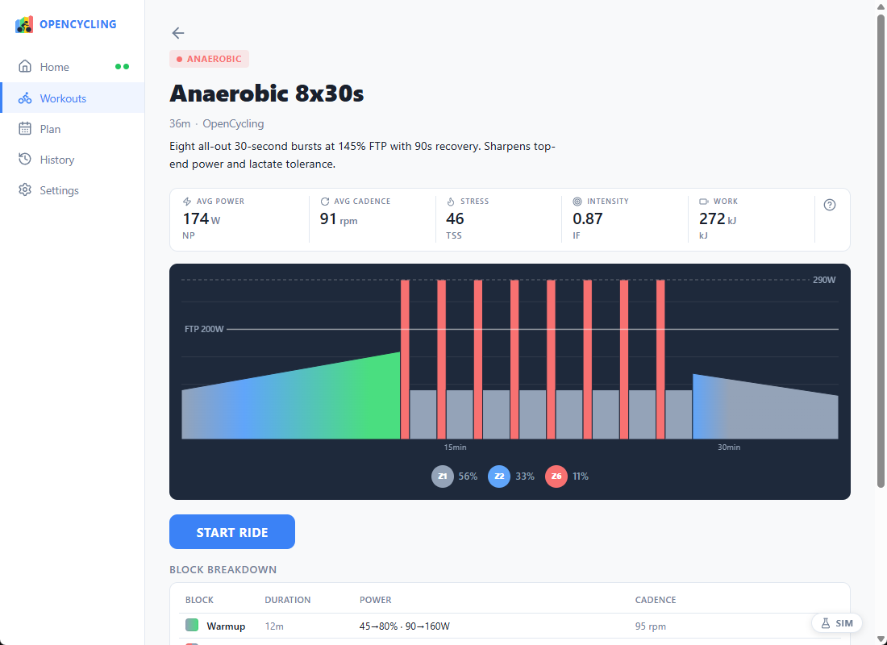
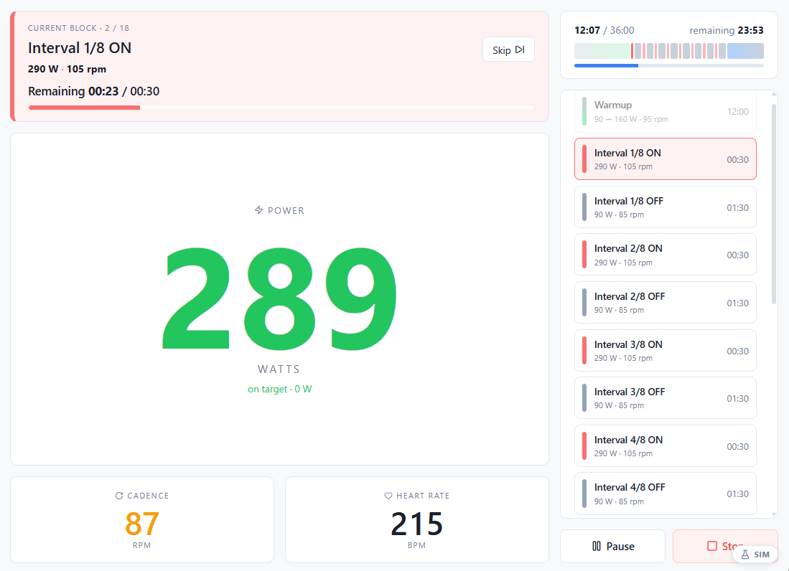
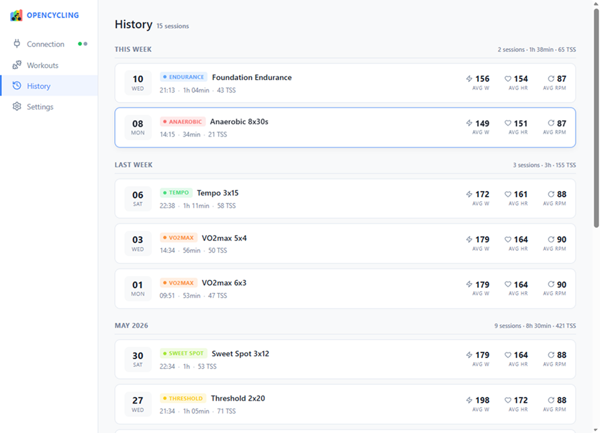
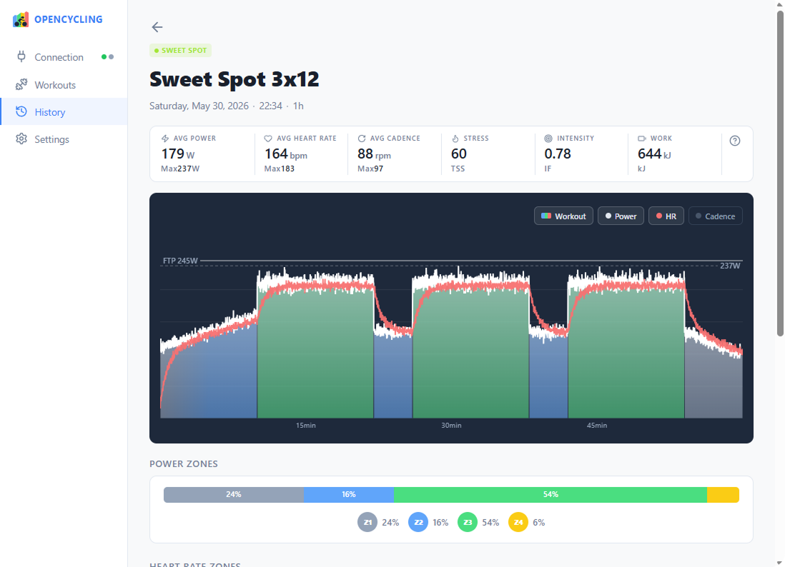
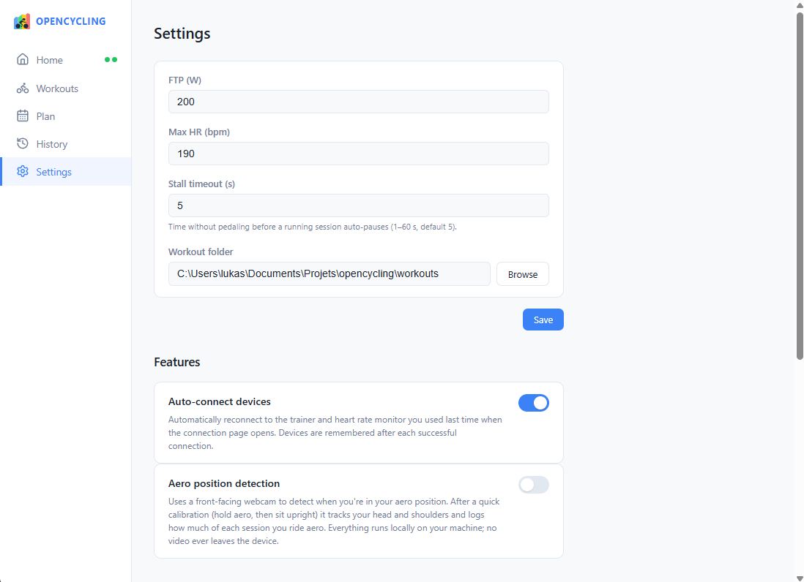

<h1 align="center">OpenCycling</h1>
<p align="center"></p>

Open-source desktop app for **structured indoor cycling in ERG mode**. It connects to your smart trainer over Bluetooth, runs `.zwo` workouts by setting the target power for you, and records every session. Offline, no account, no subscription.

## Download

Get the latest installer from the **[Releases page](https://github.com/TheElysium/opencycling/releases/latest)**:

| OS | File |
|---|---|
| Windows (main target) | `opencycling_x.y.z_x64-setup.exe` (or `.msi`) |
| Linux | `.AppImage`, `.deb` or `.rpm` |

## Quick start

1. Open **Settings**: set your `.zwo` folder, **FTP** and **max HR**.
2. Power on your trainer, then connect it (and an optional HR strap) from the home page.
3. Pick a workout, start it, and pedal: the session begins on its own.

## What it does

- Structured `.zwo` workouts in ERG, with pause and skip block
- Multi-week training plans
- Built-in FTP ramp test
- Live view (power, HR, cadence, timeline) and audio cues
- Session history with power graph and zone breakdowns
- TCX export and optional Strava upload ([setup](docs/strava-setup.md))
- Optional webcam aero-position detection (offline)

<table>
  <tr>
    <td width="33%"></td>
    <td width="33%"></td>
    <td width="33%"></td>
  </tr>
  <tr>
    <td width="33%"></td>
    <td width="33%"></td>
    <td width="33%"></td>
  </tr>
  <tr>
    <td width="33%"></td>
    <td width="33%"></td>
    <td width="33%"></td>
  </tr>
</table>

## Compatibility

Any BLE **FTMS** trainer and **HRS** heart-rate strap should work. Verified so far: Decathlon D500 (trainer) and Polar H9/H10/OH1 (HR). ERG only: no free-ride or slope mode.
Devices are matched by name prefix (`D500`, `Polar`), so other brands may need a small code change (see `AGENTS.md`).

## Contributing

Prerequisites: [Node + pnpm](https://pnpm.io/), [Rust stable](https://rustup.rs/), [Tauri v2 deps](https://tauri.app/start/prerequisites/).

```bash
pnpm install
pnpm tauri dev          # run the app
bash scripts/gate.sh    # run all checks (run before opening a PR)
```

No trainer? Run in simulation mode: `$env:OPENYCLING_SIM = "1"; pnpm tauri dev` (details in [docs/simulation.md](docs/simulation.md)).

Architecture, conventions and constraints are in **[AGENTS.md](AGENTS.md)**. It is written for AI agents but works as the dev guide too.

Bugs and feature requests: [GitHub issues](https://github.com/TheElysium/opencycling/issues) (include OS, trainer model, steps, and the app log).

## License

GPL-3.0-or-later, see [LICENSE](LICENSE). © 2026 Luka Signe--Morice
